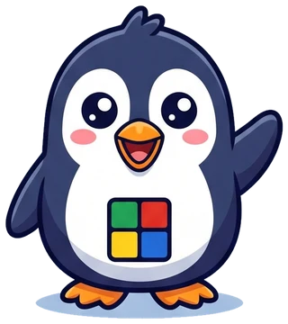
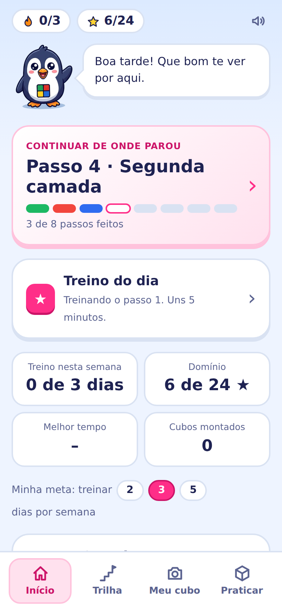
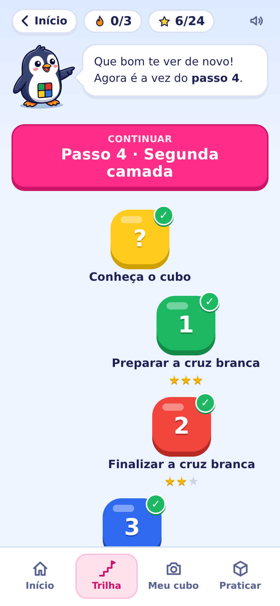
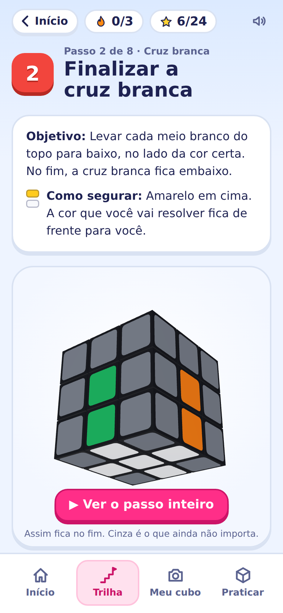
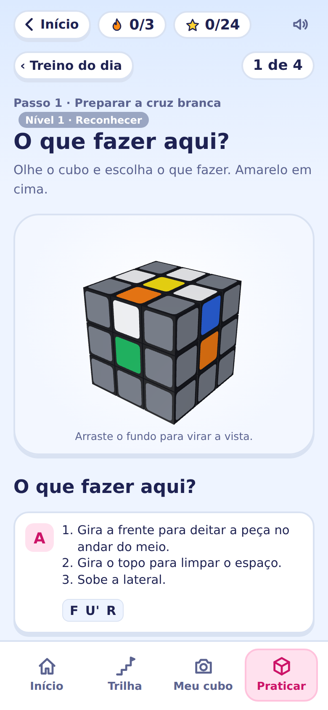
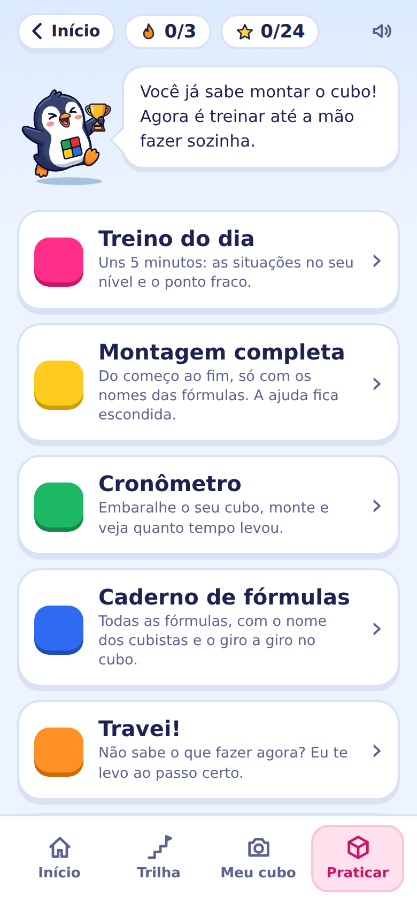

<div align="center">



# Giro a Giro

**Aprenda a montar o cubo mágico 3x3, um giro de cada vez.**<br/>
Um app em português, com o Pingo do seu lado, do primeiro giro até a montagem sem ajuda.

[](https://psicologiatech.github.io/giro-a-giro/)

[](https://github.com/psicologiatech/giro-a-giro/actions/workflows/deploy.yml)


</div>

<p align="center">
  
  
  
  
  
</p>

---

## 🧊 Para quem é

Para quem **nunca montou um cubo mágico** e quer conseguir pela primeira vez. Não é um app de speedcubing: a meta é a primeira conquista e, depois dela, a autonomia.

| | Momento | O que acontece |
|:-:|---|---|
| 🟨 | **Conhecer** | As peças (centros, meios, quinas), as faces, as camadas e os giros, com o dedo. |
| 🟩 | **Montar pela primeira vez** | Uma trilha de 8 passos pelo método das camadas, uma peça de cada vez, conferindo no seu cubo de verdade. |
| 🟦 | **Treinar** | Repetição espaçada, em níveis, até a lógica e a memória da mão ficarem de vez. |

## 🐧 A ideia

Aprender como numa boa aula: um passo de cada vez, vendo as situações que podem aparecer no seu cubo e o que fazer em cada uma. A linguagem é visual (**margarida, janela, parzinho, peixinho, terremoto**) e, ao lado, vêm os nomes que os cubistas usam (**Sune, A-perm, U-perm…**), para a pessoa conseguir conversar com a comunidade depois.

---

## 🗺️ A trilha

<table>
<tr><th>Passo</th><th>O que você faz</th><th>Como os cubistas chamam</th><th>Situações</th></tr>
<tr><td></td><td>Preparar a cruz branca</td><td>Margarida</td><td align="center">4</td></tr>
<tr><td></td><td>Finalizar a cruz branca</td><td>Cruz branca</td><td align="center">3</td></tr>
<tr><td></td><td>Primeira camada</td><td>Quinas brancas</td><td align="center">4</td></tr>
<tr><td></td><td>Segunda camada</td><td>Segunda camada</td><td align="center">3</td></tr>
<tr><td></td><td>Cruz amarela</td><td>OLL (cruz)</td><td align="center">5</td></tr>
<tr><td></td><td>Face amarela</td><td>Orientar as quinas · Sune</td><td align="center">7</td></tr>
<tr><td></td><td>Arrumar as quinas</td><td>PLL · A-perm</td><td align="center">5</td></tr>
<tr><td></td><td>Arrumar os meios</td><td>PLL · U-perm</td><td align="center">5</td></tr>
</table>

Em cada passo:

- **Objetivo e como segurar o cubo**, com a imagem de como ele fica no fim
- **Ver o passo inteiro**: o Pingo faz o passo completo, peça por peça (dá para parar a apresentação)
- **As situações possíveis**, cada uma com pré-visualização, falas giro a giro e as letras (que dá para esconder)
- **Sua vez**: você faz no cubo da tela, com uma seta mostrando o próximo giro, ou no seu cubo de verdade
- O app **percebe quando o passo ficou pronto** e leva para o seguinte

> ✅ As 36 situações e as fórmulas são verificadas automaticamente num cubo simulado, a cada publicação.

---

## ✨ O que o app tem

### 🏠 Início
Um painel com o passo da vez, o Treino do dia, a constância da semana, as estrelas de domínio, o melhor tempo e atalhos.

### 📷 Meu cubo
A câmera lê as 6 faces do seu cubo e diz **em que passo ele está**, levando direto para lá. Sem câmera, dá para pintar as cores tocando.

### ⭐ Estrelas de domínio e constância
Em vez de pontos e "ofensiva", cada passo tem 3 estrelas que mostram o quanto você já sabe (24 no total):

| Estrela | Significa |
|:-:|---|
| ★☆☆ **Vi** | Viu o passo sendo feito |
| ★★☆ **Fiz** | Fez o passo com a ajuda do app |
| ★★★ **Sei** | Fez sem ajuda |

A **constância** é semanal: você escolhe a meta (2, 3 ou 5 dias por semana) e o app conta os dias de treino de segunda a domingo. Faltar um dia não zera nada.

### 🎯 Treino do dia e Meu plano
Uns 5 minutos por dia, em duas partes: um **aquecimento** com as situações que estão vencendo na revisão e o **ponto fraco** (o passo com menos estrelas).

O plano é uma **escada**: começa só no passo 1, e o passo seguinte entra quando todas as situações do anterior chegam ao nível 2. Cada situação tem o seu nível, que sobe quando você acerta e desce um quando erra:


| Nível | Como é a pergunta |
|:-:|---|
| 1 · Reconhecer | Escolher entre 2 opções |
| 2 · Escolher | Escolher entre 3 opções parecidas |
| 3 · Lembrar | Lembrar sem opções e conferir |
| 4 · Fazer | Fazer no cubo da tela, sem a seta |
| 5 · Dominar | Fazer só pelo nome da situação |

### 🧩 Praticar (abre depois do passo 8)
- **Montagem completa**: do começo ao fim, só com os nomes das fórmulas, no cubo da tela ou no seu
- **Cronômetro**: com pausa, embaralhamento opcional, melhor tempo e média de 5
- **Caderno de fórmulas**: as 10 fórmulas com os nomes dos cubistas e o giro a giro animado
- **Travei!**: descobre em que passo você está e leva até ele
- **Cubo livre**: para brincar, com os giros do cubo inteiro (x, y, z)

### 🛒 Cubos que o Pingo recomenda
Três cubos indicados, do mais em conta ao mais caprichado, com uma explicação do que faz um cubo ser bom para começar. Os links são de afiliada do Mercado Livre e isso aparece escrito na tela, antes dos cubos.

### ☁️ Conta opcional
Dá para usar sem conta, com tudo guardado no aparelho. Quem quiser entra com o Google e o progresso passa a ser sincronizado entre celular e computador (Firebase, plano gratuito). Cada pessoa só acessa o próprio progresso, e dá para apagar a conta pelo app. Veja a [política de privacidade](https://psicologiatech.github.io/giro-a-giro/privacidade.html).

---

## 📲 Como instalar

O Giro a Giro é um **PWA**: instalado, ele ganha ícone, abre em tela cheia e funciona sem internet.

| Aparelho | Como fazer |
|---|---|
| 🤖 **Android** (Chrome) | Menu **⋮** → **Instalar app** |
| 🍎 **iPhone** (Safari) | **Compartilhar** → **Adicionar à Tela de Início** |
| 💻 **Computador** (Chrome/Edge) | Ícone de instalar na barra de endereço |

---

## 🚀 O que vem a seguir, por prioridade

1. 🤖 **App Android na Google Play**: o mesmo PWA, empacotado (teste fechado com 12 pessoas por 14 dias)
2. 🛡️ **App Check do Firebase**: proteção extra da nuvem, perto do lançamento
3. 📐 **Tablet**: telas aproveitando o espaço maior (cubo e instruções lado a lado)
4. 🦯 **Acessível para pessoas cegas**: compatível com leitor de tela, com o Pingo falando as instruções em voz e pensado para cubos táteis

---

## 🛠️ Para desenvolver

```bash
npm install
npm run dev      # abre em http://localhost:5173/giro-a-giro/
npm test         # testes do cubo, das situações, das fórmulas e do progresso
npm run build    # gera a versão de produção em dist/
```

Cada envio para a branch `main` roda os testes e publica o site no GitHub Pages pelo GitHub Actions.

<details>
<summary><b>📁 Como o código está organizado</b></summary>

<br/>

| Pasta / arquivo | O que tem |
|---|---|
| `src/cube/model.ts` | O cubo em números (posições e cores), sem desenho. É aqui que os algoritmos são testados. |
| `src/cube/CubeScene.ts` | O desenho 3D (three.js), o arrastar com o dedo e a seta do próximo giro. |
| `src/cube/fromFacelets.ts` | Monta o cubo a partir das 54 cores e confere se ele é possível. |
| `src/cube/solver.ts` | O método das camadas em lances explicados, testado com 3000 cubos embaralhados. |
| `src/scan/` | Câmera e leitura das cores, comparando cada adesivo com os centros do próprio cubo, na mesma luz. |
| `src/aulas/aulas.ts` | Os 8 passos e as 36 situações. |
| `src/aulas/progresso.ts` | Passos feitos e detecção do passo em que o cubo está. |
| `src/aulas/formulas.ts` | O caderno de fórmulas. |
| `src/aulas/dominio.ts` | Estrelas de domínio e constância semanal. |
| `src/aulas/revisao.ts` | Revisão espaçada, níveis e a escada do plano de treino. |
| `src/nuvem/` | Conta Google e sincronização com o Firestore (carregados só quando a pessoa usa). |
| `src/screens/` | As telas: Início, Trilha, Conheça o cubo, Passos, Meu cubo, Treino do dia, Praticar, Montagem completa. |
| `firestore.rules` | Regras do banco: cada pessoa lê e grava só o próprio documento. |

</details>

---

<div align="center">


Ideia, direção e conteúdo de **Karol Alves** · [PsicologiaTech](https://github.com/psicologiatech)<br/>
<sub>Ilustrações do Pingo geradas com o Gemini (Google), a partir da ideia e da direção da Karol.</sub>

</div>
